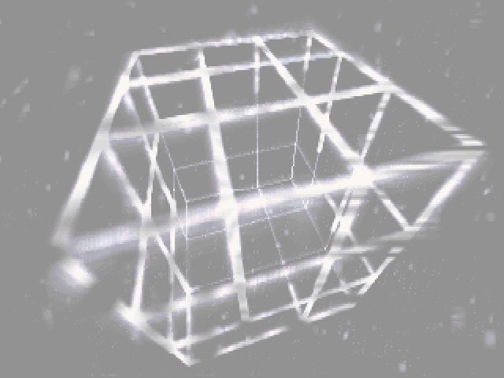
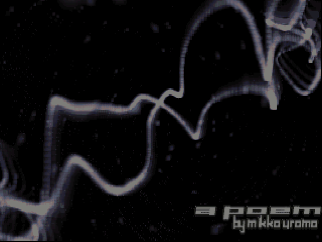
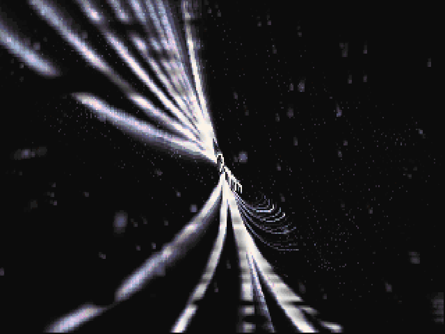
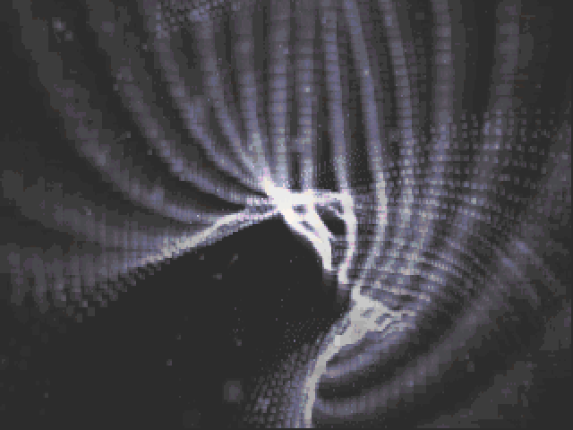

# Bjoer

TPOLM · 64k intro · 1997

- Code: Raven
- Graphics: Feather
- Music: Croaker

Production: https://www.pouet.net/prod.php?which=12

<table>
<tr>
<td></td>
<td></td>
</tr>
<tr>
<td></td>
<td></td>
</tr>
</table>

These four stills are newly computed frames of the JavaScript intro with its
original palette. They are documentation images; the player renders its graphics
live and does not play screenshots or recorded video.

## Run on Windows

Double-click **Start.cmd**. It opens the intro in your browser. Keep the small
server window open while watching; close it when you are finished.
Windows PowerShell is sufficient. No installation or npm packages are needed.

Alternatively, with Node.js installed, run `node server.mjs` and open
http://localhost:1997. The folder can also be uploaded to a static web host.
Use a current browser with Web Audio and module support. Opening `index.html`
directly as a file does not work because browsers block loading the local assets.

## Controls

- Space: play or pause
- Left / right, or −15s / +15s: seek fifteen seconds
- F: fullscreen
- Esc: stop and return to the title
- Drag the progress bar to choose a position; seeking starts when released.
- Volume: adjust the native MXM music replay.
- Stats for nerds: toggle displayed FPS and a scrolling sixteen-channel tracker.

A **Loading** overlay remains visible during a seek until graphics and music are
ready. Graphics checkpoints are five seconds apart; audio checkpoints are fifteen
seconds apart. Seeking restores the preceding state and computes forward.

## Links

The entry page links to three explanations in **effects-explained**, following
[Nation Zero's](https://github.com/kdrapel/jamm-nation0) layout approach:

- [Twisting cube](effects-explained/cube-twirl-explainer.html): cubic curves,
  position-dependent rotations, projection and sprite stamps.
- [Sprites & transparency](effects-explained/sprite-rendering-explainer.html):
  additive intensity, indexed colors and two-buffer composition.
- [MXM music](effects-explained/mxm-explainer.html): module structure, tracker
  timing, the effects used by Bjoer and an inspector of the actual patterns.

The pages include interactive controls and navigation back to the intro, without
external font downloads. Educational diagrams are labeled as illustrations.

## Contents

The standalone package includes the translated JavaScript runtime, original
native MXM patterns and instrument samples, and compressed machine-state
checkpoints for seeking. Checkpoints contain execution state, not playable video
or recorded audio. Every displayed intro frame is freshly computed after restore;
the software mixer generates stereo audio from the module.

The landing logos are extracted from JS-rendered frames using the original bitmap
masks. Its looping spline background executes the original graphics from seconds
2–6, before the number sprites appear, with the live VGA palette and a dark overlay
for readability. Playback presents the 320 × 200 image inside a 320 × 240 canvas.

The `docs/images` stills are used only by this README. No DOSBox executable,
capture archive or reverse-engineering toolchain is needed to run the player.

## Migration

The port follows the same reverse-engineering strategy as Nation Zero, with
JavaScript generating the graphics and replaying the original music module.

GPT models and a local model assisted with the port:

- **Sol 6.1 (low)** did most of the reverse-engineering, translation, integration
  and debugging.
- **Luna 6 (medium)** contributed to a smaller part of the work.
- **Qwen 3.8 27B 2b Prism**, running locally on 16GB AMD card with llama, assisted with bounded analysis and review tasks.

## Migration Recipe

The practical workflow was to establish a faithful executable baseline first,
then understand and optimize it one routine and scene at a time.

1. **Start from the IDA disassembly.** The user disassembled the original intro
   with IDA before the agent work began. That disassembly provided the starting
   point for identifying routines, addresses and data used throughout the port.

2. **Build the oracle before porting.** One of the first agent tasks was to build
   the reference and comparison infrastructure. Instrument DOSBox-X to export
   memory, CPU registers, x87 state and VGA state, prepare capture procedures,
   and establish offline execution and comparison tools around Unicorn. The
   user operated the emulator and supplied snapshots; the agents analyzed those
   artifacts offline. Check the CPU core and cycle settings so timing assumptions
   are explicit. Extend the oracle as new routines and validation needs emerge.

3. **Recover routines and data.** Inspect the original machine code and identify
   scene entry points, buffers, geometry, sprite textures, palettes and tracker
   state. Extract the native MXM module from memory, checking its pattern and
   sample boundaries. Preserve the original data rather than recreating assets
   by eye.

4. **Translate behavior before simplifying it.** Build a JavaScript execution
   path close to the original instructions, retaining memory layout, integer
   behavior and x87 precision and rounding. This instruction-level baseline is
   useful for debugging even when it is too slow for smooth playback.

5. **Validate bounded pieces with Unicorn.** Start original machine code and JS
   from the same saved state, run to a defined boundary, and compare registers,
   memory, graphics buffers, palettes and instruction counts where applicable.
   Investigate the first mismatch before extending the translated path. Agreement
   with Unicorn validates that interval; it does not by itself prove original
   hardware timing or complete-intro correctness.

6. **Extend through complete scenes.** Connect curve evaluation, deformation,
   projection, additive sprite drawing and indexed-buffer composition. Use the
   supplied DOSBox captures and video to check the visible result and scene
   progression. Reference images guide validation; they are not substituted for
   generated frames in the player.

7. **Profile, replace, and compare again.** Measure expensive scenes and replace
   hot instruction paths with direct JavaScript kernels, including spline,
   transformation and sprite routines. Preserve operation order and rounding
   where they affect results. Check optimized output against the baseline and
   independent reference before adopting a change. Keep only measured gains;
   several candidate optimizations were slower or within measurement noise.

8. **Replay music and align the clocks.** Retain the translated tracker's note,
   effect and envelope processing, and supply a software stereo mixer for the
   original MXM samples. Implement interpolation, panning and sample loops, then
   test chunk invariance, loop boundaries and tracker-state progression. Use
   the supplied video as an additional music-timing reference. Let the audio
   clock drive presentation so slow graphics can reduce their update rate
   without deliberately stopping the soundtrack.

9. **Package and make navigation practical.** Keep oracle captures and development
   tools in their folder, final release in another folder. Follow a predefined
   browser layout and controls. Generate JS-state checkpoints for seeking,
   preserving graphics state and audio voice positions, loop directions and
   fractional timing. Restore state and compute forward rather than playing
   cached frames or recorded sound.

10. **Check the experience and state the remaining limits.** Review the port in
   the browser for visual fidelity, synchronization, scene performance, seeking
   and fullscreen behavior. Use concrete observations to select the next task,
   and keep unverified behavior explicit. Tracker-state checks and deterministic
   mixer tests do not establish sample-exact GUS audio reproduction; comparison
   against an independent reference WAV remains pending.

## Current limits

Playback ends at 170 seconds. Full original startup, IRQ/display timing and
shutdown remain unfinished, and the graphics schedule is provisional. The
software mixer is not a bit-exact GUS implementation. Expensive scenes can still
run slowly and cause visual lag relative to audio.

The runtime and checkpoints are specific to Bjoer; this package is not a
general-purpose DOS emulator or MXM/XM player.
